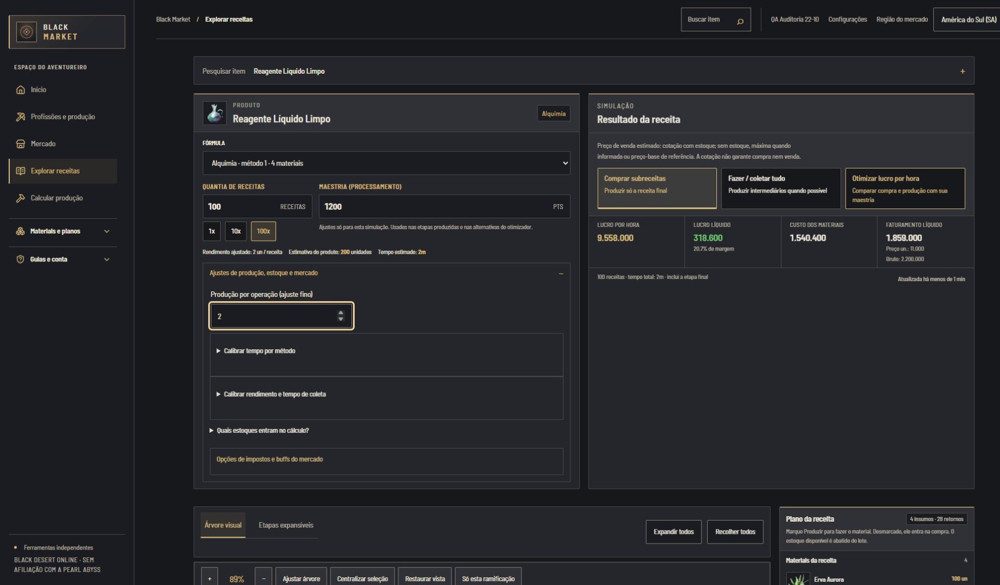

# Black Market

Planejador independente para jogadores de **Black Desert Online**, com foco inicial na região SA e no português brasileiro. Reúne receitas, materiais e cotações para ajudar a planejar a produção e organizar o inventário.

O projeto está em desenvolvimento. Ele não é afiliado à Pearl Abyss, e o código aberto não implica a publicação de um serviço hospedado.



_Captura da aplicação em desenvolvimento; os valores apresentados dependem das premissas da simulação._

## O que o projeto faz

- Explora receitas e sub-receitas em uma árvore de produção.
- Compara compra e produção de materiais, considerando preços, maestrias e tempo informado.
- Consulta itens e preços de mercado com indicação da origem e da disponibilidade dos dados.
- Permite organizar materiais e revisar sugestões de leitura de capturas antes de salvá-las.
- Oferece ferramentas de cálculo e planejamento para diferentes atividades do jogo.

Preços, resultados de OCR e cálculos podem depender de dados incompletos ou de fontes externas. Confira as premissas exibidas na aplicação antes de tomar decisões no jogo.

## Arquitetura

Monorepo em TypeScript com **Angular e SSR**, **NestJS**, **PostgreSQL**, **Drizzle** e **Docker Compose**. As regras de cálculo compartilhadas são usadas pelo navegador e pela API.

| Diretório                             | Responsabilidade                             |
| ------------------------------------- | -------------------------------------------- |
| `apps/web`                            | Interface Angular e renderização no servidor |
| `apps/api`                            | API, catálogo e integrações                  |
| `packages/calculators`                | Cálculos compartilhados                      |
| `packages/database`                   | Schema e migrations                          |
| `packages/domain` e `packages/shared` | Contratos e utilitários                      |

Consulte [arquitetura](docs/architecture.md) e o [índice da documentação](docs/README.md) para detalhes.

## Rodar localmente

Requisitos: Node.js **24.21.0**, pnpm **10.28.1**, Docker e Docker Compose. Em um clone novo, crie `.env` a partir de `.env.example` e siga as instruções de [desenvolvimento local](docs/development.md). Não substitua um `.env` ou banco existente.

```sh
corepack enable
corepack prepare pnpm@10.28.1 --activate
pnpm install --frozen-lockfile
docker compose up -d postgres
pnpm db:migrate
```

Depois, em terminais separados:

```sh
pnpm dev:api
pnpm dev:web
```

A interface fica em `http://localhost:4200` e a API em `http://localhost:3000`. A rota `/ready` verifica a conexão da API com o banco. Para executar a aplicação inteira em containers, consulte a seção de Docker em [desenvolvimento local](docs/development.md).

### Catálogo e dados do jogo

O clone **não inclui um banco populado nem o conjunto de assets extraídos do jogo**. Para carregar o catálogo, consulte o [pipeline de dados](docs/data-pipeline.md) e as [atualizações do catálogo](docs/catalog-updates.md). A extração depende de uma instalação legítima do jogo e de ferramenta comunitária com licença própria; verifique os termos aplicáveis antes de usar ou redistribuir dados e imagens.

As cotações usam integrações comunitárias e podem estar desatualizadas ou indisponíveis. A coleta persistente não deve ser ativada sem revisar as condições da fonte. Capturas e dados pessoais devem permanecer fora do Git.

## Qualidade e contribuição

```sh
pnpm check
pnpm test
pnpm build
```

Antes de contribuir, consulte [desenvolvimento e qualidade](docs/development.md) e descreva o problema ou a proposta em uma issue. Não inclua credenciais, arquivos do jogo, catálogos extraídos ou capturas privadas em contribuições.

## Licença e conteúdo de terceiros

O código de autoria do projeto está disponível sob a [licença MIT](LICENSE). Nomes, marcas, imagens, dados do jogo e outros conteúdos de terceiros pertencem aos respectivos titulares e não são licenciados por este projeto. Veja [procedência dos dados](docs/data-pipeline.md).

---

**English:** Black Market is an independent, work-in-progress planning tool for Black Desert Online. It combines nested recipes, production costs, market data and screenshot review. The repository does not provide a populated game database or extracted assets. See [local development](docs/development.md) and [data sources](docs/data-pipeline.md).
