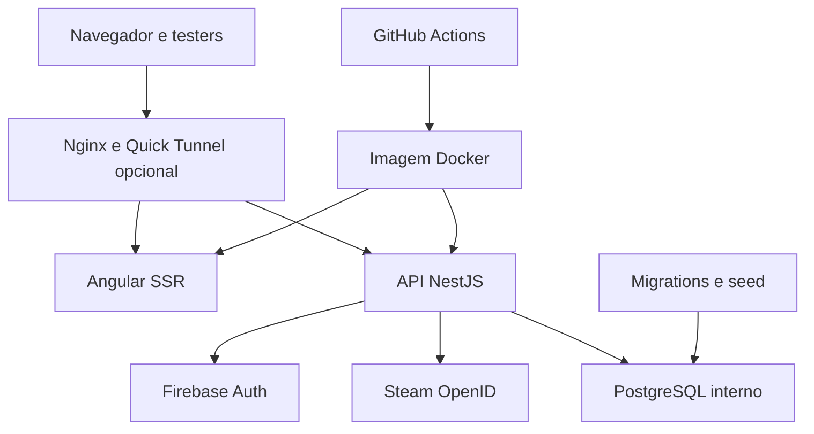

# Modelo de ameaças — Black Market

**Data:** 15/10/2026
**Escopo:** checkout local, API NestJS, web Angular SSR, PostgreSQL local/staging, autenticação Firebase/Steam, CI e scripts de operação.
**Contexto confirmado:** staging separado da produção, até dez testers, somente dados sintéticos. Login pretendido: Google e Steam.

## Executive summary

O código atual tem bons controles de autenticação e autorização na API, separação entre credencial de migração e role de runtime, portas do staging presas a loopback, containers de API/web endurecidos e validação de origem/tamanho de requisição. Corrigi localmente dois riscos operacionais no staging: acesso Quick Tunnel agora exige de 1 a 10 e-mails distintos, e o seed exclui workspaces, identidades, transações de Steam e dados de mercado. O banco local de staging está separado, atualizado e sem usuários ou workspaces. **Não posso certificar a segurança de produção:** não existe `.env.production` nem banco hospedado identificável neste ambiente. Antes de disponibilizar a plataforma, os principais pontos restantes são ausência de RLS no PostgreSQL, backups locais sem criptografia demonstrada e configuração externa de Firebase/staging ainda ausente.

## Scope and assumptions

- In scope: `apps/api`, `apps/web`, `packages/database`, `deploy`, `docker-compose.staging.yml`, `scripts/staging*`, `.github/workflows/ci.yml`, configurações e documentação de staging.
- Out of scope: configuração real de contas Firebase, Cloudflare, provedor/hosting de produção, secrets de CI e banco remoto de produção; nenhum desses recursos foi identificado ou acessado nesta revisão.
- Uso esperado: site público para Mercado/Receitas/Crafting; login Google/Steam para áreas pessoais; ambiente staging independente, limitado a 1–10 testers e com dados sintéticos.
- O staging desta máquina responde em `http://localhost:8081`; gateway está publicado somente em `127.0.0.1`. Nenhum túnel público estava aberto durante a revisão.
- O arquivo `.env.production` não existe. `.env` e `.env.staging` são locais/ignorados pelo Git; verifiquei apenas nomes/presença de configurações, sem exibir valores. Firebase não está configurado no staging.
- Ao validar o banco local, encontrei zero linhas em `auth_users`, `auth_identities` e `user_workspaces`. A role de runtime não é superuser, não tem membership e tem 21 grants de leitura. Nenhuma tabela tem RLS ativa.
- Perguntas que alterariam a classificação: qual hospedagem/banco será usada em produção; quais controles de backup/criptografia existem fora do repositório; qual política de retenção/exclusão de conta será adotada.

## System model

### Primary components

- Web: Angular SSR; navegador acessa as páginas públicas e as áreas privadas autenticadas.
- API: NestJS recebe JSON, valida workspace, autentica Firebase ID tokens e valida Steam OpenID no backend.
- Banco: PostgreSQL; migrations usam credencial administrativa interna; API usa `black_market_app`.
- Provedores: Firebase Authentication para Google/custom token Steam; Steam OpenID para identidade Steam.
- Operação: Docker Compose para dev/staging/produção; Nginx gateway; scripts PowerShell de staging/backup; GitHub Actions.

### Data flows and trust boundaries

- Navegador → gateway Nginx: HTTP local em loopback; opcionalmente Cloudflare Quick Tunnel com proteção por e-mail OTP; Nginx aplica limites de requisição e roteia para web/API. O Quick Tunnel não estava ativo.
- Navegador → API: JSON e Firebase bearer token; CORS restringe a origem configurada, rotas pessoais usam `private, no-store`, o body geral é 256 KB e workspace/backup é 20 MB.
- API → Firebase: Admin SDK verifica ID token com revogação habilitada. Chave Admin é lida pela API do ambiente e não deve ir ao cliente.
- Navegador/API → Steam: cliente inicia Steam OpenID; API valida retorno e estado e troca código de uso único por custom token Firebase. A integração real depende de credenciais e domínios externos.
- API → PostgreSQL: rede Docker interna; API usa role runtime sem superuser/DDL/`BYPASSRLS`; operações pessoais derivam owner do token verificado e filtram `user_workspaces.user_id`. Não há RLS como segunda barreira.
- Script de seed → PostgreSQL dev/staging: dump copia estrutura/catálogo e exclui linhas pessoais, de auth/Steam e de mercado. Staging recusa restore se o banco não estiver vazio.
- CI → código/dependências: valida sintaxe PowerShell, guards e scripts; a auditoria de dependências de produção não encontrou advisories após atualizar `@grpc/grpc-js`.

#### Diagram

## Assets and security objectives

| Asset                                                                  | Why it matters                                                             | Security objective (C/I/A) |
| ---------------------------------------------------------------------- | -------------------------------------------------------------------------- | -------------------------- |
| Workspace por conta: família, personagens, inventário/armazéns e scans | Dados pessoais de jogo e preferências; exposição cruzada viola privacidade | C/I/A                      |
| Firebase UID, vínculo Steam e estado temporário de login               | Liga identidade social a dados pessoais; roubo pode permitir acesso        | C/I                        |
| Credenciais PostgreSQL e Firebase Admin                                | Acesso administrativo, leitura e alteração de dados                        | C/I/A                      |
| Dumps, manifests e assets                                              | Cópias podem sobreviver à exclusão e expor dados                           | C/I/A                      |
| Catálogo e preços/histórico                                            | Integridade afeta cálculos e recomendações; disponibilidade afeta o app    | I/A                        |
| Imagens Docker, lockfile e pipeline                                    | Artefato comprometido executa código no runtime com acesso às credenciais  | I/A                        |

## Attacker model

### Capabilities

- Atacante remoto não autenticado pode enviar requisições públicas e tentar abuso de endpoints, validação ou limites.
- Tester autenticado pode manipular suas requisições, dados de workspace, quantidades e conteúdo de imagem no cliente.
- Atacante com acesso ao computador do mantenedor pode ler `.env`, banco e dumps locais se as proteções do host forem insuficientes.
- Dependência ou workflow comprometido pode modificar artefatos durante build.

### Non-capabilities

- Não assumi acesso ao projeto/conta Firebase, Cloudflare, GitHub Secrets, servidor ou banco de produção.
- Não encontrei porta PostgreSQL/API publicada diretamente no Compose de staging.
- Não assumi que login real esteja ativo: Firebase externo está sem configuração, e não houve teste de provedor real.

## Entry points and attack surfaces

| Surface                       | How reached                 | Trust boundary                 | Notes                                                                                | Evidence                                                                             |
| ----------------------------- | --------------------------- | ------------------------------ | ------------------------------------------------------------------------------------ | ------------------------------------------------------------------------------------ |
| Mercado/catálogo e SSR        | Browser → Nginx → web/API   | Internet → app                 | Dados públicos; limites no gateway; respostas de catálogo são cacheáveis             | `deploy/nginx.staging.conf:30-76`; `apps/api/src/main.ts:33-43`                      |
| Workspace GET/PUT/DELETE      | API com bearer token        | Browser → API → DB             | Owner vem da identidade verificada; payload validado por schema; respostas sem cache | `apps/api/src/workspace/workspace.controller.ts:16-35`; `workspace.service.ts:12-64` |
| Identidade Firebase/Steam     | Browser → API/provedores    | Browser → API → IdP            | ID token verifica revogação; fluxos reais dependem de config externa                 | `firebase-auth.service.ts:24-25`; `identity.service.ts:149-173`                      |
| Corpo JSON e backups pessoais | API                         | Cliente não confiável → parser | Limites 256 KB/20 MB                                                                 | `apps/api/src/main.ts:42-43`; `http-policy.ts:6-10`                                  |
| Quick Tunnel                  | Operador executa `Share`    | Mantenedor → Internet/testers  | Allowlist obrigatória de 1–10 emails; túnel temporário, nenhum ativo agora           | `scripts/staging.ps1:153-171`; `staging-guards.ps1:1-18`                             |
| Seed de staging               | Operador executa `Seed`     | DB dev → DB staging            | Exclui dados pessoais, auth/Steam e mercado; só aceita staging vazio                 | `scripts/staging.ps1:112-133`; `staging-guards.ps1:21-31`                            |
| Migrations/permissões         | Compose interno             | Operador/admin → DB            | Credencial administrativa separada da API                                            | `docker-compose.staging.yml:47-55`; `deploy/runtime-role.sql:6-24`                   |
| Imagem/dependências           | GitHub Actions/Docker build | Código/registry → runtime      | Lockfile versionado; auditoria atual de produção limpa                               | `.github/workflows/ci.yml`; `package.json:29-33`; `pnpm-lock.yaml`                   |

## Top abuse paths

1. Um bug de tenant em endpoint pessoal → role lê tabelas sem RLS → atacante autenticado consulta registro de outra conta → família/armazém expostos. Queries atuais filtram owner, mas a proteção depende da API.
2. Acesso ao host → dump local legível e `.env` → credenciais ou dados copiados são extraídos → exposição do staging e possível acesso a serviços com segredo reutilizado.
3. Operador compartilha staging → allowlist de e-mail limita acesso ao Quick Tunnel → tester entra no site; sem Firebase separado, as áreas pessoais não podem ser testadas. A proteção atual falha fechada se a lista não vier.
4. Restore de dados pessoais via seed → workspaces/UIDs/tentativas de Steam copiados para staging → contas de teste correlacionadas com dados reais. A exclusão das tabelas está implementada e a consulta ao staging atual encontrou zero linhas pessoais.
5. Dependência/build alterado → código malicioso na imagem → acesso às credenciais runtime disponíveis ao container. Lockfile e CI reduzem risco, mas não substituem proteção de registry, revisão e secrets do fornecedor de deploy.

## Threat model table

| Threat ID | Threat source                            | Prerequisites                                                                                             | Threat action                                                                             | Impact                                                                                                                               | Impacted assets                         | Existing controls (evidence)                                                                                                                                                                                              | Gaps                                                                                                                            | Recommended mitigations                                                                                                                                                                | Detection ideas                                                                                           | Likelihood    | Impact severity | Priority |
| --------- | ---------------------------------------- | --------------------------------------------------------------------------------------------------------- | ----------------------------------------------------------------------------------------- | ------------------------------------------------------------------------------------------------------------------------------------ | --------------------------------------- | ------------------------------------------------------------------------------------------------------------------------------------------------------------------------------------------------------------------------- | ------------------------------------------------------------------------------------------------------------------------------- | -------------------------------------------------------------------------------------------------------------------------------------------------------------------------------------- | --------------------------------------------------------------------------------------------------------- | ------------- | --------------- | -------- |
| TM-001    | Tester malicioso ou falha de autorização | Precisa estar autenticado e encontrar uma rota pessoal com filtro de owner ausente/incorreto.             | Explorar a role global de leitura para acessar workspace de outra conta.                  | Vazamento entre contas; role tem SELECT em 21 tabelas e não há RLS. Consultas atuais de workspace filtram o owner derivado do token. | Workspace, identidades e dados da conta | Firebase `verifyIdToken(..., true)`; owner server-side; queries com `user_id`; role sem superuser/membership e com `NOBYPASSRLS` (`identity.service.ts:149-173`, `workspace.service.ts:12-64`, `runtime-role.sql:13-24`). | Banco local confirmou zero tabelas RLS e 21 grants SELECT ao runtime. Defesa multitenant depende da correção de todas as rotas. | Projetar contexto de owner por transação; habilitar e forçar RLS em dados pessoais; restringir SELECT a tabelas necessárias; adicionar testes de integração negativos entre duas UIDs. | Alertar queries pessoais sem owner; métricas/logs estruturados de 401/403; teste periódico de isolamento. | Baixa         | Alta            | medium   |
| TM-002    | Pessoa com acesso ao host/backup         | Host ou pasta de backup acessível; impacto depende da criptografia de disco do host, não verificada aqui. | Copiar dump de staging e consultar dados/catálogos/configuração operacional.              | Exposição de dados que existam no dump e indisponibilidade por perda/alteração.                                                      | Dumps, dados pessoais e continuidade    | Manifesto SHA-256 e retenção local; staging tem banco próprio (`scripts/backup-database.ps1:22-23`, `docs/staging-local.md:83`).                                                                                          | SHA-256 verifica integridade, não cifra; não há destino externo protegido implementado no repositório.                          | Cifrar antes de sair do host, guardar em storage separado com ACL/MFA, testar restauração e limitar retenção.                                                                          | Monitorar falha/atraso do backup e executar restore drill periódico.                                      | Média         | Alta            | medium   |
| TM-003    | Configuração incorreta de produção       | Publicação em ambiente externo sem checklist/credenciais corretas.                                        | Usar banco/Firebase/segredos compartilhados com dev ou staging, ou publicar porta/backup. | Acesso cruzado e perda de dados.                                                                                                     | Dados de produção e credenciais         | Compose separa staging; role runtime de menor privilégio; `.env*` ignorado pelo Git.                                                                                                                                      | Produção real e permissões do banco remoto não puderam ser inspecionadas; `.env.production` ausente.                            | Antes do deploy, validar projeto/banco separados, TLS, portas, grants, rotação de segredos e backup; revisar configuração efetiva do host, sem enviar secrets ao Git.                  | Checklist de deploy automatizado, alerta de URL/projeto divergente e verificação de portas/health.        | Indeterminada | Alta            | high     |
| TM-004    | Seed/compartilhamento mal configurado    | Operador executa seed ou `Share` sem revisar dados/convites.                                              | Copiar identidades pessoais ao staging ou abrir túnel sem lista de testers.               | Associação de contas reais em staging ou acesso indesejado.                                                                          | Dados de identidade/workspace e staging | Guard exige 1–10 e-mails; dump exclui workspaces, Auth, Steam e mercado (`staging-guards.ps1:1-31`). DB staging atual tem zero linhas nessas tabelas; nenhum túnel ativo.                                                 | Fix está no checkout local ainda não commitado; ainda não executamos login real/seed sintético sem projeto Firebase.            | Manter fail-closed; configurar Firebase separado; semear somente depois do primeiro login da UID designada; manter e-mails fora do Git.                                                | Logar início de share/seed sem e-mail, checar contagem de linhas antes de abrir túnel.                    | Baixa         | Média           | low      |

## Criticality calibration

Os exemplos abaixo definem prioridade possível para este projeto; não são achados observados.

- **Critical:** token administrativo de produção comprometido; bypass de autenticação que exponha todos os workspaces; execução remota no container com acesso a credenciais de produção.
- **High:** leitura/escrita cross-tenant em todas as contas; banco de produção exposto sem autenticação; backup de produção acessível publicamente.
- **Medium:** bug em rota que expõe workspace de outra UID, mas exige login; dump de staging não cifrado perdido com dados de tester; esgotamento direcionado de endpoint autenticado.
- **Low:** catálogo público adulterado sem acesso a dados pessoais; indisponibilidade breve de função pública com recuperação; inconsistência em informação de mercado sem mudança no saldo do usuário.

## Focus paths for security review

| Path                                                        | Why it matters                                              | Related Threat IDs |
| ----------------------------------------------------------- | ----------------------------------------------------------- | ------------------ |
| `apps/api/src/workspace/identity.service.ts`                | Token social, mapeamento de UID e owner canônico            | TM-001, TM-003     |
| `apps/api/src/workspace/workspace.service.ts`               | Validação e isolamento de dados pessoais                    | TM-001             |
| `deploy/runtime-role.sql`                                   | Grants efetivos, privilégio mínimo e evolução de permissões | TM-001, TM-003     |
| `packages/database/src/schema.ts`                           | Tabelas pessoais e desenho para RLS                         | TM-001             |
| `docker-compose.production.yml`                             | Configuração real de rede, secrets e credenciais de runtime | TM-003             |
| `docker-compose.staging.yml`                                | Isolamento do staging e portas expostas                     | TM-003, TM-004     |
| `scripts/staging.ps1` e `scripts/staging-guards.ps1`        | Convites e cópia de dados entre ambientes                   | TM-004             |
| `scripts/backup-database.ps1` e `scripts/restore-drill.ps1` | Confidencialidade e recuperação dos dumps                   | TM-002             |
| `.github/workflows/ci.yml` e `pnpm-lock.yaml`               | Integridade do código e dependências no build               | TM-003             |

## Notes on use

- A atualização do staging e os guards estão no checkout local; não houve push, deploy de produção nem túnel público.
- O staging local usa imagem `black-market:staging-20261015013234`, banco PostgreSQL separado e responde no smoke test. Login Google/Steam ainda não pode ser testado: configuração Firebase externa, UID seed e lista de testers não foram fornecidas.
- `pnpm audit --prod --audit-level high` encontrou zero advisories conhecidos depois do override de `@grpc/grpc-js` para `1.14.6` (commit local `36e559b`).
- A compilação otimizada de staging passa com avisos de tamanho; o build de produção permanece bloqueado pelos limites estritos existentes (bundle inicial 1,05 MB > 1,00 MB; `recipe-tree.scss` 38,77 KB > 20 KB). Isso é questão de build/performance, não comprovação de segurança.
- A revisão estática e o banco local não substituem uma auditoria do ambiente produtivo, teste de invasão ou verificação das configurações do provedor.

## Quality check

- [x] Entry points públicos, pessoais, auth, seed, migrations e CI incluídos.
- [x] Cada trust boundary relevante aparece no modelo e em abuse paths.
- [x] Runtime separado de tooling/CI; atacantes e operadores diferenciados.
- [x] Resposta confirmada: Firebase/DB de staging separados e dados sintéticos.
- [x] Premissas, limites e perguntas abertas sobre produção e backups registrados.
