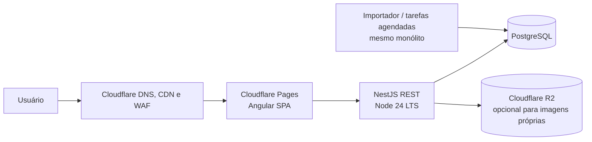

# Arquitetura

## Objetivos

- Custo e carga operacional baixos para um projeto pessoal e poucos usuários.
- Uma base monolítica modular, sem serviços distribuídos prematuros.
- Catálogo de jogo, dados de mercado e cálculos com procedência visível.
- Poder migrar API e PostgreSQL entre provedores usando Node e `DATABASE_URL` padrão.

## Componentes

O Cloudflare Pages entrega apenas os arquivos estáticos do Angular. A API Nest roda num host Node/container, pois o processo Nest requer um runtime Node convencional; Pages Functions/Workers não substituem esse servidor. API e banco começam num único provedor para reduzir conexões e configuração. Cloudflare fica na borda, DNS e proteção; R2 só entra se houver arquivos que o projeto tenha direito de armazenar.

## Monorepo

- `apps/web`: Angular standalone, rotas por funcionalidade e carregamento sob demanda conforme as áreas crescerem.
- `apps/api`: NestJS com módulos por domínio (`catalog`, `market`, `crafting`, `enhancement`, `auth`, `users`). Controllers REST finos, serviços de aplicação e validação de entrada.
- `packages/shared`: formatos comuns da API, paginação e procedência.
- `packages/domain`: identificadores e tipos do jogo, independentes do framework.
- `packages/calculators`: aritmética exata reutilizável. `percentageOf` opera em `bigint` e pontos-base; não codifica fórmula de mercado ou regra de jogo.
- `packages/database`: schema Drizzle, migrations e cliente tipado.

As regras completas de cada calculadora serão criadas junto com suas fontes verificadas. Cálculos de resposta rápida podem rodar no browser, mas tipos e regras determinísticas devem ser compartilhados e conferidos no servidor antes de persistir resultados.

## Caminho de uma requisição

1. Angular pede recursos versionados em `/api/v1`.
2. Nest valida região, parâmetros e paginação, aplica timeout e cache curto quando fizer sentido.
3. Serviços consultam PostgreSQL; nenhum endpoint público consulta diretamente o banco do jogo.
4. Respostas de mercado incluem região, fonte e horário de observação/coleta.
5. Uma tarefa do mesmo deploy importa catálogo e coleta preços com limites definidos; ela não bloqueia as requisições da API.

## Decisões de escala

- PostgreSQL é a fonte persistente inicial; cache em memória com TTL curto atende hot lists. Sem Redis, filas ou busca externa até haver carga que justifique operação adicional.
- Índices começam pelos padrões de acesso medidos: item/região/horário e IDs de relacionamento. Evitar guardar JSON completo duplicado sem uma necessidade clara.
- `DATABASE_URL` e migrations permitem usar PostgreSQL gerenciado. Para pooler, configure um pool pequeno na aplicação e confirme o limite de conexões do provedor.
- Histórico de mercado tem política de retenção e agregação a decidir antes de coletar em alta frequência; uma linha por item por minuto cresce rapidamente.
- Coleta de preços é melhor executada pelo próprio processo Node ou por cron do host. Cloudflare Cron pode chamar um endpoint autenticado, mas não mantém execução persistente de jobs.

## Fases

1. Estrutura e ambiente: Angular, Nest, schema/migration, health checks, docs e CI. **Implementada nesta entrega.**
2. Importação manual versionada de catálogo/receitas do extractor; busca e detalhes de item. **Implementada.**
3. Mercado: consulta Arsha por ID com cache implementada. Coleta agendada e histórico global controlado permanecem no roadmap.
4. Calculadoras manuais de mercado, crafting, enhancement, failstacks, RNG, atividade, treino e gear implementadas com testes. Tabelas específicas por item e regras automáticas dependem de datasets verificados.
5. Contas e sincronização de preferências somente se houver necessidade; começar sem login.
6. Mapas, planejamento e recursos adicionais conforme validação de uso.

## Ferramentas pessoais e mercado sob demanda

A entrega Black Market adiciona módulos calculators e market no NestJS e rotas Angular por ferramenta. O pacote calculators gera ESM para o browser e CommonJS para o backend; contém validação e regras reutilizadas nas duas plataformas. As ferramentas calculam localmente para resposta imediata e podem conferir o resultado pela API.

O shell inicial carrega apenas navegação, região e contagens de metadados pessoais. A validação completa dos dados e as regras entram com as rotas de ferramenta, reduzindo o pacote inicial. RegionPreferences mantém a seleção regional; WorkspaceStore carrega e valida o backup local ao abrir uma ferramenta.

Dados pessoais começam no navegador com backup versionado, sem login. O PostgreSQL continua persistindo o catálogo. MarketService consulta Arsha por ID, com cache em memória; não guarda histórico global nem cria jobs. A matriz de recursos implementados e pendentes está em feature-coverage.md.

## Padrões do frontend

Angular standalone com rotas lazy, OnPush e estado derivado com signals. Serviços HTTP, schemas, apresentação e persistência têm responsabilidades separadas. Tailwind 4 e SCSS usam entradas próprias e tokens comuns. Vitest roda testes unitários e de componentes pelo builder oficial Angular. A organização e os critérios para novas funcionalidades estão em [arquitetura Angular](angular-architecture.md).
