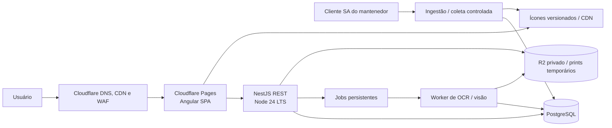

# Arquitetura

## Objetivos

- Plataforma pública brasileira de BDO, com ferramentas gratuitas e planejamento personalizado; SA e pt-BR como padrões iniciais.
- Custo e carga operacional baixos durante o início, com crescimento de usuários e uploads controlado.
- Uma base monolítica modular, sem serviços distribuídos prematuros.
- Catálogo de jogo, dados de mercado e cálculos com procedência visível.
- Poder migrar API e PostgreSQL entre provedores usando Node e `DATABASE_URL` padrão.

A [visão do produto](product-vision.md) define fluxos, recomendações e ordem de entrega. A instalação local do jogo alimenta o catálogo central; visitantes não executam o extractor.

## Componentes



O diagrama descreve a produção planejada. Hoje catálogo/receitas estão no PostgreSQL local; preços têm consulta por ID com cache em memória; dados pessoais ficam no navegador. Contas, uploads, worker e recomendações ainda não foram implementados.

O Cloudflare Pages entrega apenas os arquivos estáticos do Angular. A API Nest roda num host Node/container, pois o processo Nest requer um runtime Node convencional; Pages Functions/Workers não substituem esse servidor. API e banco começam num único provedor para reduzir conexões e configuração. Cloudflare fica na borda, DNS e proteção; R2 só entra se houver arquivos que o projeto tenha direito de armazenar.

## Monorepo

- `apps/web`: Angular standalone, rotas por funcionalidade e carregamento sob demanda conforme as áreas crescerem.
- `apps/api`: NestJS com módulos por domínio. Catálogo, mercado e calculadoras já existem; identidade/perfil, scans, estoque sincronizado e recomendações serão módulos próprios. Controllers REST finos, serviços de aplicação e validação de entrada.
- `packages/shared`: formatos comuns da API, paginação e procedência.
- `packages/domain`: identificadores e tipos do jogo, independentes do framework.
- `packages/calculators`: aritmética exata reutilizável. `percentageOf` opera em `bigint` e pontos-base; não codifica fórmula de mercado ou regra de jogo.
- `packages/database`: schema Drizzle, migrations e cliente tipado.

As regras completas de cada calculadora serão criadas junto com suas fontes verificadas. Cálculos de resposta rápida podem rodar no browser, mas tipos e regras determinísticas devem ser compartilhados e conferidos no servidor antes de persistir resultados.

## Caminho de uma requisição

1. Angular pede recursos versionados em `/api/v1`.
2. Nest valida região, parâmetros e paginação, aplica timeout e cache curto quando fizer sentido.
3. Serviços consultam PostgreSQL; nenhum endpoint público consulta diretamente o banco do jogo.
4. Respostas de mercado incluem região, fonte e horário de observação/coleta.
5. Na produção planejada, tarefas separadas importam catálogo e coletam preços com limites definidos; não bloqueiam as requisições da API.

## Decisões de escala

- PostgreSQL é a fonte persistente inicial; cache em memória atende a consulta atual. Jobs de scans exigem fila durável: começar com PostgreSQL e worker limitado, sem Redis ou busca externa até haver carga que justifique operação adicional.
- Índices começam pelos padrões de acesso medidos: item/região/horário e IDs de relacionamento. Evitar guardar JSON completo duplicado sem uma necessidade clara.
- `DATABASE_URL` e migrations permitem usar PostgreSQL gerenciado. Para pooler, configure um pool pequeno na aplicação e confirme o limite de conexões do provedor.
- Histórico de mercado tem política de retenção e agregação a decidir antes de coletar em alta frequência; uma linha por item por minuto cresce rapidamente.
- Coleta de preços é melhor executada pelo próprio processo Node ou por cron do host. Cloudflare Cron pode chamar um endpoint autenticado, mas não mantém execução persistente de jobs.

## Fases

1. Estrutura e ambiente: Angular, Nest, schema/migration, health checks, docs e CI. **Implementada nesta entrega.**
2. Importação manual versionada de catálogo/receitas do extractor; busca e detalhes de item. **Implementada.**
3. Mercado: consulta Arsha por ID com cache implementada. Coleta agendada e histórico global controlado permanecem no roadmap.
4. Calculadoras manuais de mercado, crafting, enhancement, failstacks, RNG, atividade, treino e gear implementadas com testes. Tabelas específicas por item e regras automáticas dependem de datasets verificados.
5. Contas e sincronização de perfil/estoque: requisito do produto público para guardar dados privados e usar em vários dispositivos. Consultas públicas permanecem sem login.
6. Recomendações explicáveis com entrada manual, depois leitura revisável de prints e modelos de coleta por maestria/rota.
7. Mapas e outros conjuntos do catálogo conforme prioridade do produto.

## Ferramentas pessoais e mercado sob demanda

A entrega Black Market adiciona módulos calculators e market no NestJS e rotas Angular por ferramenta. O pacote calculators gera ESM para o browser e CommonJS para o backend; contém validação e regras reutilizadas nas duas plataformas. As ferramentas calculam localmente para resposta imediata e podem conferir o resultado pela API.

O shell inicial carrega apenas navegação, região e contagens de metadados pessoais. A validação completa dos dados e as regras entram com as rotas de ferramenta, reduzindo o pacote inicial. RegionPreferences mantém a seleção regional; WorkspaceStore carrega e valida o backup local ao abrir uma ferramenta.

Dados pessoais começam no navegador com backup versionado, sem login. O PostgreSQL continua persistindo o catálogo. MarketService consulta Arsha por ID, com cache em memória; não guarda histórico global nem cria jobs. A matriz de recursos implementados e pendentes está no [catálogo de pedidos](project-feature-checklist.md).

Isso descreve o estado da implementação, não o destino da plataforma. Local storage evolui para cache/rascunho e modo visitante. A migração para conta deve ter prévia e resolução de conflitos, sem sobrescrever silenciosamente dados do servidor.

## Dados públicos e privados

Itens, receitas, preços e calculadoras gratuitas funcionam sem conta. Perfil sincronizado, imagens e planos persistentes exigem identidade do Black Market; não pedir senha/token da conta do jogo. A identidade vem da sessão validada no servidor, não de um `userId` enviado pelo browser. Todo acesso a dados pessoais e objetos de imagem verifica o dono.

Ícones de catálogo são assets públicos por versão; prints são objetos privados e temporários. O job de ingestão publica o catálogo no PostgreSQL e seus assets em armazenamento de produção/CDN. Não é necessário commitar imagens ou JSONs no Git. A escolha final do provedor de identidade acompanha o deploy; preferir uma integração consolidada a implementar armazenamento próprio de senhas.

## Scans e processamento assíncrono

A API autoriza upload e acesso temporário a imagens, valida formato/tamanho e cria o job. Também limitar pixels decodificados, duração e concorrência. Um worker da mesma base/imagem Docker processa jobs fora do ciclo HTTP e grava um rascunho; não aplica estoque automaticamente.

Uma fila inicial em PostgreSQL usa claim atômico, lease, retries limitados e idempotência. Separar filas/limites de OCR e mercado. Confirmar um rascunho exige transação, controle de versão e deduplicação de prints/slots; retries não podem duplicar quantidades. Prints parciais não substituem todo um armazém.

O domínio de estoque consome dados confirmados, vindos de entrada manual, CSV ou print. Recomendações usam esse mesmo perfil; trocar o adaptador de OCR não muda o modelo de estoque. Avaliar OCR textual e reconhecimento de ícones separadamente. Um ícone compartilhado não prova o nível de aprimoramento ou a variante de um item.

## Motor de recomendações

Regras determinísticas em `packages/calculators` recebem perfil/estoque confirmados, cotações e versões do catálogo/modelo. Filtrar por orçamento, energia, requisitos, equipamento, maestria e preferências. Comparar prata líquida, desembolso, custo de oportunidade dos materiais, tempo ativo/AFK e liquidez observada. Registrar premissas para reproduzir e explicar o resultado.

Simulações não debitam nem reservam materiais. Uma reserva posterior exige ação explícita e evita consumir o mesmo estoque em dois planos. Dados de rendimento desconhecidos exigem taxa informada/medida ou retornam dados insuficientes. O dataset atual de mastery cobre cozinha, alquimia e processamento; coleta por maestria/rota precisa de fonte e validação adicionais.

## Operação pública com baixo custo

Começar com uma API, PostgreSQL, um worker limitado e armazenamento de objetos. API e worker escalam separadamente com a mesma imagem. Imagens ficam fora do banco; nele ficam metadados, jobs, dados confirmados e resultados. Modelos de OCR entram sob demanda na rota de importação, fora do bundle inicial.

Antes de múltiplas réplicas da API, coordenar limites/cache de mercado para não multiplicar chamadas externas. Priorizar preços populares e itens usados em planos; evitar varrer todo o catálogo continuamente. Preservar último preço válido com indicação de idade/indisponibilidade. Retenção e agregação do histórico devem ser definidas antes de ativar coleta persistente.

Medir latência, falhas/frescor de preços, fila/tempo/custo de scans, correções de reconhecimento e diferença entre retorno previsto e observado. A [visão do produto](product-vision.md) detalha a experiência; [deploy](deployment.md) descreve os componentes e custos.

## Frontend Angular, estilos e testes

O frontend segue a organização por funcionalidade do [Style Guide do Angular](https://angular.dev/style-guide). Componentes são standalone, páginas usam `loadComponent`, e a detecção de mudanças usa `OnPush`. Bootstrap, providers e rotas permanecem em `main.ts`, `app.config.ts` e `app.routes.ts`.

### Responsabilidades

```text
apps/web/src/
  app/
    core/
      region-preferences.ts       Preferência e resumo regional leve
      workspace-models.ts         Schemas, tipos e estado inicial
      workspace-store.ts          Persistência e recuperação
      catalog-api.service.ts      Acesso HTTP ao catálogo
    features/
      market/
        market-api.ts             Acesso HTTP da funcionalidade
        market-api.spec.ts        Contrato HTTP isolado
        market-page.ts            Estado e ações da página
        market-page.html          Template
        market-page.spec.ts       Interação e renderização
      crafting/ ...               Demais funcionalidades
    shared/                      Componentes, feedback e formatação
    layout/                      Navegação e região global
    testing/                     Helpers exclusivos dos specs
  styles/
    tailwind.css                 Entrada Tailwind/PostCSS e tema
    _tokens.scss                 Paleta compartilhada
    _base.scss                   Base e acessibilidade
    _layout.scss                 Páginas e painéis
    _forms.scss                  Formulários
    _metrics.scss                Indicadores
    _feedback.scss               Avisos e estados
    _tables.scss                 Tabelas
    _controls.scss               Controles reutilizados
    _visualizations.scss         Gráficos e progresso
    _responsive.scss             Ajustes responsivos comuns
  styles.scss                    Composição com @use
```

As regras financeiras ficam em `@bdo/calculators`, compartilhado com NestJS. Componentes coordenam entrada, estado e apresentação; serviços fazem HTTP; o store trata persistência. Schemas e formatação não dependem da classe do store. Arquivos e specs relacionados ficam juntos. Serviços exclusivos ficam na funcionalidade; `core` contém serviços transversais e `shared` contém elementos reutilizados.

Use `inject()`, signals para estado reativo, `computed()` para derivação, inputs/outputs com signals em novos componentes, `@if`/`@for` e bindings de classe/estilo. A aplicação usa o comportamento zoneless do Angular atual. Campos com FormsModule são atualizados por eventos do Angular. Subscriptions e timers devem ser liberados ao destruir componentes. Separe componentes quando tiverem uma responsabilidade própria.

### Tailwind e SCSS

Tailwind 4.3.3 usa `@tailwindcss/postcss`. Sua entrada CSS é processada pelo PostCSS; Sass compila `styles.scss` e estilos locais. Essa separação permite usar ambos sem passar o código Tailwind pelo Sass, considerando a [orientação de compatibilidade do Tailwind](https://tailwindcss.com/docs/compatibility#sass-less-and-stylus). A [documentação Angular](https://angular.dev/guide/tailwind) descreve a integração PostCSS.

Use Tailwind para layout, espaçamento e responsividade. Use SCSS para apresentação dos componentes, regras comuns e tokens. A paleta SCSS gera propriedades `--bm-*`; o `@theme inline` expõe os mesmos valores como utilitários `text-market-accent` e `bg-market-surface`. Classes Tailwind devem aparecer completas nos templates.

Estilos globais semânticos ficam na camada `components`; base e tokens ficam em `base`. A camada `utilities` pode sobrescrevê-los. Estilos locais usam o encapsulamento padrão do Angular. Evite `::ng-deep`, importar Tailwind em cada SCSS e transformar todas as classes em `@apply`.

O CLI gera componentes standalone com SCSS, OnPush e specs:

```powershell
pnpm --filter @bdo/web exec ng generate component features/market/quote-card
```

### Vitest unitário e de componentes

O target `@angular/build:unit-test` usa explicitamente Vitest 4.1.11 com `tsconfig.spec.json`. O builder prepara a compilação Angular e o DOM jsdom conforme a [configuração oficial de testes](https://angular.dev/guide/testing).

```powershell
pnpm --filter @bdo/web test              # Todos os testes do frontend
pnpm --filter @bdo/web test:unit         # Serviços, HTTP e funções puras
pnpm --filter @bdo/web test:components   # Páginas e componentes reutilizados
pnpm --filter @bdo/web test:watch        # Modo interativo
```

Specs ficam ao lado do código, com sufixo `.spec.ts`. Testes puros não precisam de TestBed. Serviços com DI usam TestBed; HTTP usa `provideHttpClientTesting` e `HttpTestingController`. Componentes são compilados com templates reais, recebem inputs por `componentRef.setInput`, e verificam DOM e eventos. localStorage é isolado por teste; o teardown destrói componentes e libera subscriptions/timers.

jsdom valida comportamento e templates, mas não mede layout, pixels ou desempenho de um navegador real. CI executa lint, tipos, Vitest, build de produção e verificação de migrations.
