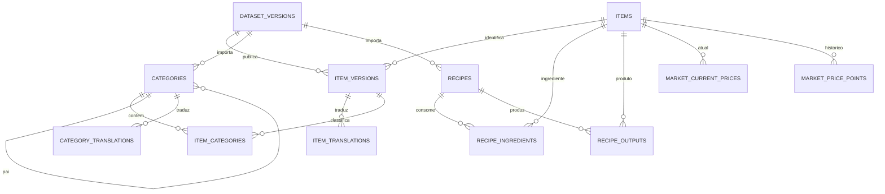

# Banco de dados

PostgreSQL é a persistência relacional. Drizzle ORM define schema TypeScript e migrations SQL versionadas; a aplicação nunca altera schema automaticamente no startup. `pnpm db:migrate` aplica as migrations em desenvolvimento ou release.

## Modelo inicial

### Tabelas presentes no schema

- `dataset_versions`: fonte, fingerprint/versão, região, idioma, checksum, contagens e estado (`loading`, `active`, `archived`, `failed`). Só uma versão pode estar ativa por fonte/região/idioma.
- `items`: identidade estável do ID do jogo. `item_versions`, `item_translations`, `categories`, `category_translations` e `item_categories` preservam valores e textos por dataset.
- `recipes`, `recipe_ingredients`, `recipe_outputs`: relações versionadas de receita, estação/tipo e quantidades ordenadas. Quantidade `NULL` significa que a fonte não a informou; não é convertida em zero ou um.
- `market_current_prices`: último valor conhecido por região e item.
- `market_price_points`: observações históricas indexadas por região/item/tempo e protegidas contra duplicação.

Valores de preço e quantidade usam `numeric`, para evitar arredondamento de `float`. Instantes são `timestamptz`. Usuários, contas externas, favoritos e storage ainda não foram criados: o MVP não deve exigir login. Quando necessário, projetar uma tabela `users` com ID interno e provedor de identidade, sem armazenar senha de terceiros.

## Publicação atômica de dataset

1. Validar `items.json`, `recipes.json` e `marketcategories.json`, IDs e referências antes de abrir uma transação.
2. Criar a versão em estado `loading` e importar linhas em lotes dentro de uma transação.
3. Arquivar a versão anterior e ativar a nova na mesma transação. Uma falha reverte os dados e mantém a versão anterior ativa; o registro da tentativa fica como `failed`.
4. Reutilizar uma versão somente se o checksum for o mesmo. Um conteúdo diferente exige novo identificador; isso impede mutação silenciosa de um snapshot.
5. Manter versões arquivadas para rollback. Removê-las só por política documentada, depois de confirmar que nenhum consumidor ainda as consulta.

O importador está disponível em `pnpm --filter @bdo/api data:import`. Ele não é executado no startup da API e não aceita upload remoto.

## Crescimento do mercado

Não gravar cada resposta repetida. O coletor deve deduplicar por fonte/região/item/horário, gravar `market_current_prices` em upsert e inserir um ponto apenas quando houver mudança ou no intervalo de amostragem escolhido. Definir expiração/rollup (por exemplo, guardar amostras detalhadas por janela curta e agregações mais longas) antes de uma coleta frequente.
