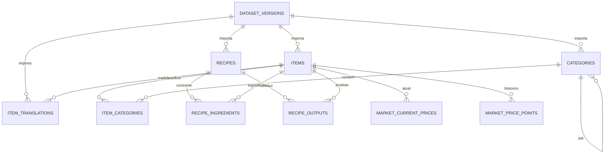

# Banco de dados

PostgreSQL é a persistência relacional. Drizzle ORM define schema TypeScript e migrations SQL versionadas; a aplicação nunca altera schema automaticamente no startup. `pnpm db:migrate` aplica as migrations em desenvolvimento ou release.

## Modelo inicial

### Tabelas presentes no schema

- `dataset_versions`: fonte, identificador da versão, checksum, contagens e estado de importação. A combinação fonte/versão é única.
- `items`, `item_translations`, `categories`, `item_categories`: IDs estáveis do jogo e texto por idioma; uma importação nova deve preservar a versão que gerou cada registro.
- `recipes`, `recipe_ingredients`, `recipe_outputs`: receita normalizada, estações/tipo e quantidades ordenadas.
- `market_current_prices`: último valor conhecido por região e item.
- `market_price_points`: observações históricas indexadas por região/item/tempo e protegidas contra duplicação.

Valores de preço e quantidade usam `numeric`, para evitar arredondamento de `float`. Instantes são `timestamptz`. Usuários, contas externas, favoritos e storage ainda não foram criados: o MVP não deve exigir login. Quando necessário, projetar uma tabela `users` com ID interno e provedor de identidade, sem armazenar senha de terceiros.

## Publicação atômica de dataset

1. Criar versão em estado `loading`.
2. Validar os JSONs e referências de IDs antes de escrever; importar em transação/lotes.
3. Conferir totais, checksum, categorias, traduções e integridade das receitas.
4. Marcar como `active` e apontar a versão corrente por seleção explícita. Se falhar, marcar `failed` e manter a versão anterior disponível.
5. Remover versões antigas só por política documentada, depois de confirmar que não há consumidores.

A tabela de versões prepara o modelo, mas a troca atômica de versão e o importer serão implementados na fase de catálogo.

## Crescimento do mercado

Não gravar cada resposta repetida. O coletor deve deduplicar por fonte/região/item/horário, gravar `market_current_prices` em upsert e inserir um ponto apenas quando houver mudança ou no intervalo de amostragem escolhido. Definir expiração/rollup (por exemplo, guardar amostras detalhadas por janela curta e agregações mais longas) antes de uma coleta frequente.
