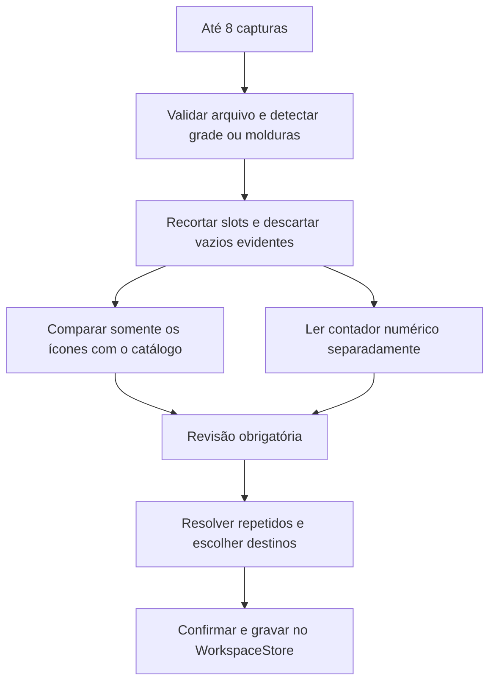

# MVP de importação por capturas

Atualizado em 9 de outubro de 2026. Este documento descreve o código implementado e separa os resultados medidos das limitações de reconhecimento.

## Escopo e arquitetura

O foco atual inclui Home, Mercado, importação, Armazéns, Inventário, Equipamentos e o [Recipe Explorer](recipe-explorer.md), habilitado pela solicitação seguinte para aproveitar os itens importados no planejamento de receitas. Catálogo, cadastro mínimo de personagem, backup, suporte e documentos legais apoiam essas jornadas. O código dos demais módulos e da demonstração foi preservado e permanece suspenso.

`SCREENSHOT_MVP`, em `packages/shared/src/mvp-scope.ts`, controla navegação, proteção das rotas e sitemap. Alterar para `false` e recompilar restaura o escopo anterior. O servidor de produção redireciona os módulos suspensos para a Home; o guard também bloqueia navegação direta no cliente. URLs desconhecidas continuam com página 404. Inventário, importação, equipamentos e backup são privados para indexação, mesmo quando usados sem conta.

Stack reutilizada: Angular, SCSS/Tailwind, NestJS, catálogo e ícones existentes, validação Zod e `WorkspaceStore`. Não foi adicionada dependência, serviço de visão pago, modelo generativo ou fila externa. O reconhecimento acontece no navegador. O custo incremental de processamento externo é zero; consultas ao catálogo e às imagens continuam usando a infraestrutura existente.



## Referência: BDO Workshop

[Storage Tracker](https://bdoworkshop.com/crafting-workshop/storage-tracker), visitado em 9/10/2026, apresenta navegação para Crafting Workshop, seleção de região e mensagem exigindo login para acessar o recurso. A interface autenticada não foi acessível nesta análise.

| Questão                                                | Evidência disponível                                         |
| ------------------------------------------------------ | ------------------------------------------------------------ |
| Acesso ao Storage Tracker                              | Exige autenticação na página visitada                        |
| Upload e apresentação dos resultados                   | Não verificados atrás do login                               |
| Comparação de ícones e OCR numérico                    | Não verificados; não atribuímos nossa técnica ao concorrente |
| Revisão, associação à cidade, repetição e persistência | Não verificados                                              |
| Implementação interna                                  | Desconhecida                                                 |

A decisão de oferecer importação local sem login, revisão explícita, destinos por captura e resolução de repetidos é nossa proposta de produto. Não constitui uma observação da implementação interna do BDO Workshop.

## Como usar

1. Cadastre o personagem em **Equipamentos** se for importar inventário ou gear.
2. Abra **Importar capturas**. Escolha, arraste ou cole até oito imagens PNG, JPEG ou WebP. Cada imagem aceita até 10 MB, 12 megapixels e dimensões mínimas de 16 × 16.
3. Informe o tipo e o destino de cada imagem. Armazém usa cidade/local; Inventário e Equipamentos usam um personagem da região selecionada.
4. Abra uma captura para conferir o contorno. Se houver duas janelas, escolha a grade correta. Ajuste o recorte, linhas e colunas quando necessário. Em gear, molduras fechadas podem ser encontradas sem uma grade regular; molduras ausentes ou recortadas exigem seleção manual de um ícone.
5. Clique em **Analisar lote**. O processamento é sequencial, com comparação de até quatro slots em paralelo e folhas numéricas de até 50 recortes. Resultados anteriores são mantidos quando outra imagem falha. É possível cancelar e tentar novamente.
6. Abra cada captura e revise os resultados. Escolha o ID correto, corrija a quantidade e marque somente o que conferiu no jogo. Use a pesquisa do catálogo quando nenhuma sugestão servir. Ignore falsos positivos e slots vazios que permanecerem na revisão.
7. Resolva os itens repetidos e confirme o modo de atualização. Nenhum dado é gravado durante o reconhecimento.
8. Consulte os itens salvos em **Armazéns**, **Inventário** ou **Equipamentos**. É possível editar manualmente. Armazéns e Inventário oferecem grade/lista, filtros, data da atualização e histórico recente. Uma remoção manual pode ser desfeita enquanto a página permanecer aberta.
9. Faça uma cópia em **Dados e backup**. Nesta etapa os dados pessoais são locais; limpar os dados do navegador pode removê-los.

Não existe exportação de armazém em CSV oferecida por este fluxo do jogo. O CSV anterior continua no código suspenso; a entrada principal do MVP é a captura ou o cadastro manual.

## Identidade visual, números e ambiguidades

- A tela inteira serve para localizar panes/slots. Não é interpretada por IA generativa.
- A comparação usa o índice `rgb-top-v2` do catálogo: descritor RGB de 8 × 8 como filtro e comparação de detalhes de 16 × 16 dos candidatos, obtidos a partir de recortes maiores. São avaliados diferentes recuos da borda.
- Molduras, marcadores no canto superior, texto de aprimoramento e região do contador são excluídos ou reduzidos na comparação. Nenhuma técnica garante isolamento perfeito de overlays em todas as interfaces.
- A distância visual exibida é um escore de semelhança, não uma probabilidade calibrada.
- IDs que compartilham um ícone permanecem ambíguos. Corda, poções, carnes e sangues podem exigir escolha manual. Um nome sugerido não significa item confirmado.
- Quantidades passam por um leitor local de silhuetas de dígitos; recortes não resolvidos podem usar o Tesseract já existente. Falha desse apoio preserva leituras locais e deixa os demais valores em branco. Cancelamento interrompe a espera do leitor; operações numéricas têm espera limitada.
- Abreviações como `264,8k` não são gravadas como quantidade exata. Ausência de contador não preenche uma unidade. Aprimoramento e Caphras não são inferidos pelo ícone: importações sem edição desses campos ficam marcadas como não confirmadas. Ao reimportar o mesmo item na mesma posição, valores anteriores são preservados como referência histórica, sem confirmar o nível atual pela imagem. Um item diferente não herda esses valores.
- Slots seguramente vazios são descartados. Texturas, sombras, imagens muito escuras e casos duvidosos podem permanecer para revisão, para reduzir descarte incorreto de itens.
- Ícones apresentados usam o componente padronizado com limite de 48 × 48, proporção preservada e `object-fit: contain`. O processamento interno mantém recortes com resolução maior.

## Duplicidades e atualização

Arquivos idênticos são identificados por SHA-256 e ficam fora do processamento automático repetido. Um hash perceptual simples da imagem reduzida sinaliza semelhança; ele não comprova sobreposição e não decide a identidade de itens.

O agrupamento usa ID do item, região, tipo e destino. Inventário usa ID estável do personagem. Aparições do mesmo item no mesmo destino, inclusive em capturas parcialmente sobrepostas, exigem decisão:

- **Última captura:** substitui pela quantidade da última ocorrência na ordem do lote; essa ordem não comprova qual screenshot foi tirada mais recentemente.
- **Maior quantidade:** mantém o maior valor observado, sem somar.
- **Pilhas distintas:** soma somente após essa escolha explícita. O mesmo arquivo/recorte é contado uma vez. Recortes distintos do mesmo arquivo mantêm posições próprias.

Modos de gravação:

| Modo                      | Efeito                                                                                                                                                                   |
| ------------------------- | ------------------------------------------------------------------------------------------------------------------------------------------------------------------------ |
| Atualizar itens revisados | Atualiza quantidades absolutas dos IDs revisados e acrescenta IDs novos. Mantém itens não vistos. É o padrão.                                                            |
| Acrescentar itens novos   | Mantém as quantidades já existentes e acrescenta apenas IDs ausentes. Não soma estoque antigo e novo.                                                                    |
| Substituir local completo | Remove itens ausentes somente nos destinos com itens importados. Exige declaração de captura completa e revisão/ignorar todos os espaços. Não use com capturas parciais. |
| Gear                      | Substitui apenas slots revisados de cada personagem. Dois equipamentos para o mesmo slot precisam ser corrigidos/ignorados.                                              |

Não há detecção perfeita de rolagem, instante de captura ou de todas as sobreposições. O usuário decide se aparições representam uma pilha repetida ou pilhas diferentes. Planos antigos que reservam estoque continuam protegidos pela validação compartilhada; uma alteração incompatível é rejeitada.

## Persistência e privacidade

O formato continua compatível com backups antigos: os novos metadados são opcionais ou têm defaults. Estoque distingue armazém/inventário e registra dono, horário e origem (hash do arquivo, espaço, captura e coordenadas do recorte quando disponíveis). O histórico conserva até 60 importações; a listagem mostra as dez mais recentes. Limite de estoque: 4.000 registros. Uma gravação inválida não altera o workspace.

Arquivos originais, imagens completas e recortes de revisão ficam apenas na memória desta página. Não são incluídos no backup nem enviados como eventos de analytics. Miniaturas são reduzidas antes da exibição. Bitmaps, URLs temporárias e leitor são liberados ao sair. O primeiro uso do OCR pode baixar arquivos de distribuição de terceiros; isso não envia a imagem para esses provedores. Eventos de importação são agregados e seguem o consentimento já existente.

Falha ao gravar no armazenamento local mantém os dados na sessão e orienta exportar um backup; isso não equivale a armazenamento durável confirmado.

## Validação reproduzível e resultados

Execute após instalar as dependências já existentes do projeto:

```sh
pnpm --filter @bdo/calculators build
pnpm --filter @bdo/web exec ng test --watch=false
pnpm --filter @bdo/api exec vitest run
pnpm --filter @bdo/web exec ng build
pnpm test:ssr
node scripts/validate-print-layouts.mjs data/ocr-layout-validation.json
node scripts/validate-print-recognition.mjs data/ocr-recognition-validation.json
```

Os manifestos locais e screenshots não são versionados. Exemplo de caso do segundo script:

```json
[
  {
    "label": "Contador legível confirmado manualmente",
    "path": "C:/caminho-local/captura.png",
    "slots": [
      {
        "bounds": { "left": 499, "top": 154, "width": 53, "height": 53 },
        "quantity": "48",
        "empty": false
      }
    ]
  }
]
```

Os recortes devem vir de referência conferida por uma pessoa. `quantity: null` significa nenhum contador legível esperado. `equipment: true` registra quantas molduras foram localizadas, sem presumir que sejam todas as posições corretas. O script retorna código 1 se a referência e a saída divergirem, incluindo casos que exigem correção manual; isso torna as limitações visíveis em vez de classificá-las como precisão perfeita.

Resultados locais observados em 9/10/2026:

| Verificação                                    | Resultado e alcance                                                                                                                                                                                                                                   |
| ---------------------------------------------- | ----------------------------------------------------------------------------------------------------------------------------------------------------------------------------------------------------------------------------------------------------- |
| Detecção de grades                             | 9/9 casos passaram: escalas, layouts largos, duas janelas e gear irregular sem grade. Não mede identidade de itens.                                                                                                                                   |
| Leitor numérico, interface usada na calibração | 12/12 contadores exatos corretos. Não é amostra independente.                                                                                                                                                                                         |
| Leitor numérico, segunda interface             | 3/9 contadores corretos, 6 sem leitura; nenhum número incorreto entre os três retornados. Exige melhoria e revisão manual.                                                                                                                            |
| Ausência de contador em oito slots vazios      | 8/8 retornaram sem quantidade; não foram preenchidos com 1.                                                                                                                                                                                           |
| Filtro de vazio                                | Conservou os 21 slots ocupados avaliados. Descartou 4/8 vazios da amostra; os outros quatro permaneceram para revisão. Amostra pequena.                                                                                                               |
| Molduras de gear                               | Localizou 12 molduras no exemplo irregular. A cobertura total e associação automática a slots não foram validadas.                                                                                                                                    |
| Benchmark local desses recortes                | Aproximadamente 30–150 ms por grupo pequeno de recortes; RSS do processo Node/Sharp observado em torno de 108 MiB. Não representa memória do navegador ou análise de telas completas.                                                                 |
| Lote real no navegador                         | Oito arquivos processados, com um recorte de slot configurado em cada um. Todos ficaram disponíveis para revisão. Tempos individuais exibidos entre 0,1 e 0,7 s naquele teste, com recursos locais/cache. Não é benchmark de oito armazéns completos. |
| Slot conhecido da corda                        | Quantidade 48 lida; família de ícones de corda sugerida; IDs compartilhados exigiram seleção manual.                                                                                                                                                  |

Testes controlados cobrem oito arquivos, duplicatas exatas, semelhança, sobreposição por ID/destino, recortes distintos, limites de valores, arquivo inválido, substituição segura de imagem, cancelamento, falha do leitor, revisão obrigatória, persistência, atualização parcial, cadastro de dono, equipamento manual e rotas suspensas. Os testes do matcher também cobrem candidatos compartilhados e dados que não correspondem ao catálogo; os do parser cobrem milhares e abreviações. Esses testes não substituem um conjunto independente de imagens rotuladas.

### Pendências de precisão

1. Criar referência independente com IDs exatos confirmados no jogo, quantidades e slots em múltiplas escalas. Sem isso, precisão global de IDs, taxa global de falsos positivos e número de correções não estão medidos.
2. Ampliar fontes numéricas/calibração: a segunda interface ainda tem seis leituras ausentes entre nove contadores avaliados. Não reduzir limiares apenas para preencher mais campos.
3. Avaliar mais ícones escuros, panes de gear com molduras incompletas e sobreposições reais de rolagem. Hoje existe detecção conservadora e resolução humana, não reconstrução automática perfeita do armazém.
4. Medir lote de oito telas completas e memória do navegador. O teste de um slot por imagem não permite extrapolar esses valores.

Build de produção apresenta aviso de bundle inicial acima de 500 kB (aproximadamente 899 kB bruto / 207 kB de transferência estimada), além do aviso de CommonJS do Tesseract e fallback da locale pt-BR para pt. O OCR continua em chunk lazy. Não há medição confiável de Lighthouse ou promessa de Core Web Vitals nesta entrega.

## Campos estruturados por imagem

A rota privada `/scans/profile` acrescenta leitura local de português para reconhecer telas de armazém, inventário, maestria, mercado, personagem e equipamento. Ela reutiliza a captura em memória, permite corrigir o tipo/área e revisa cada campo antes da aplicação. O jogador escolhe um personagem existente e confirma campo a campo; editar um valor desfaz a confirmação. A revisão compara o valor lido com o atual no perfil. Conflitos de leituras ficam ambíguos, sem escolha automática pelo score do OCR. O fluxo não cria nem combina personagens. Só valores LT podem preencher peso do perfil; LT/VT são excluídos da capacidade do inventário. Peso VT do mercado e campos sem modelo permanecem como prévia. As 13 capturas únicas atuais são um corpus local de calibração, sem grupo independente para medir acurácia. `node scripts/validate-screen-ocr.mjs data/ocr-corpus/manifest.json` conta campos exatos, ausentes, incorretos, ambíguos e não suportados sem imprimir texto OCR ou caminhos de imagem. Consulte [OCR: calibração e validação](ocr-validation.md) para limites e organização do manifesto.
